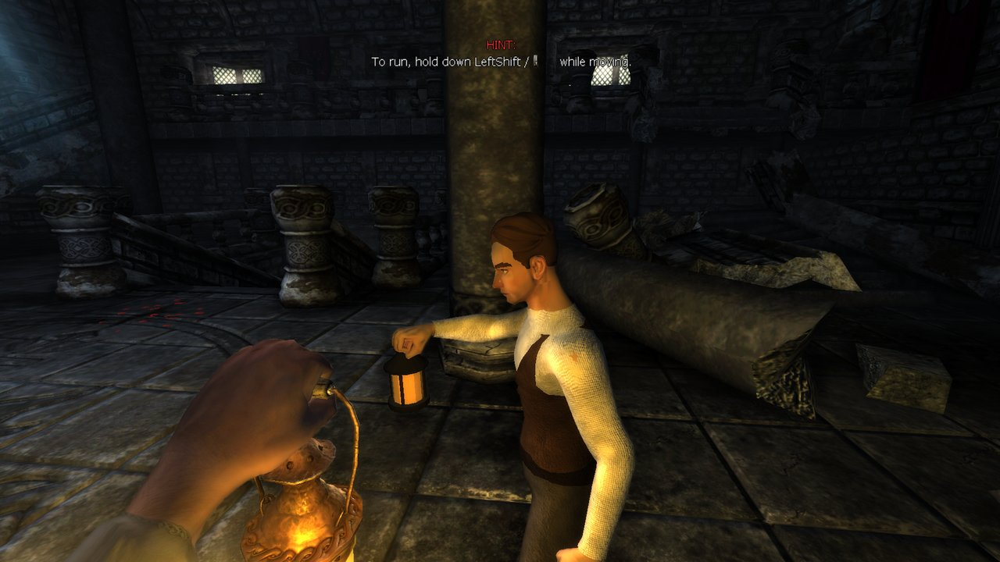
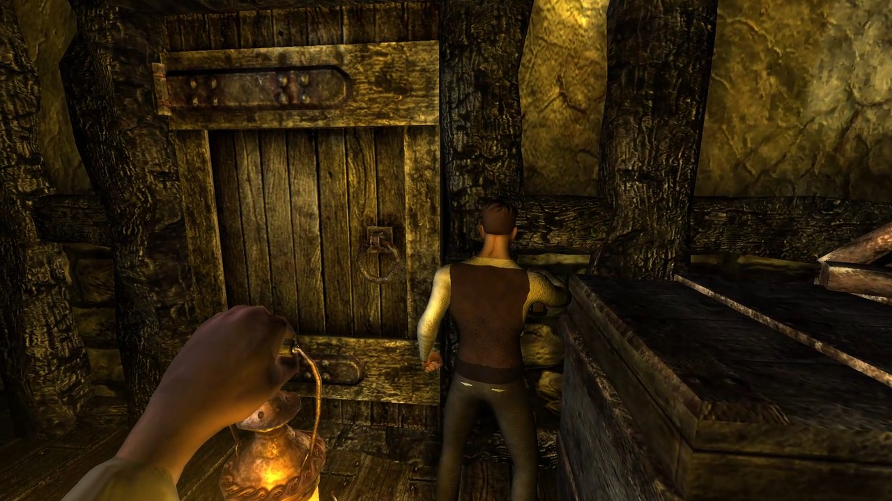
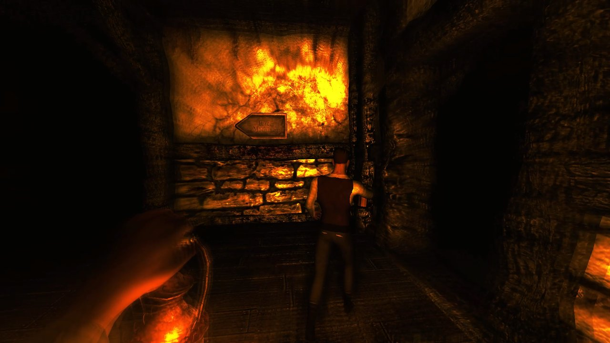
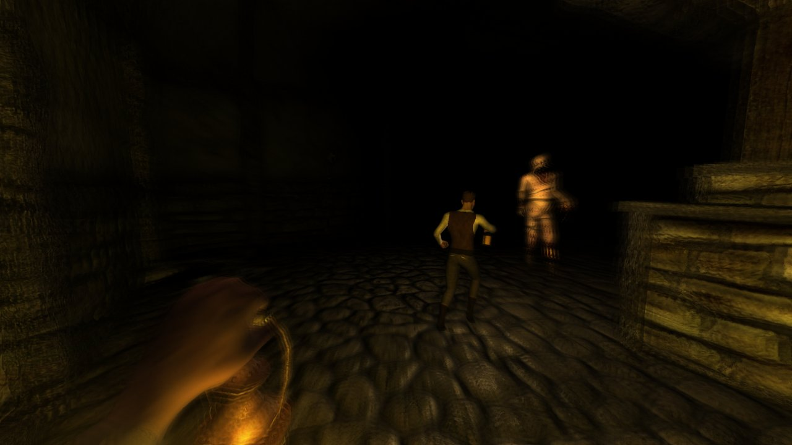
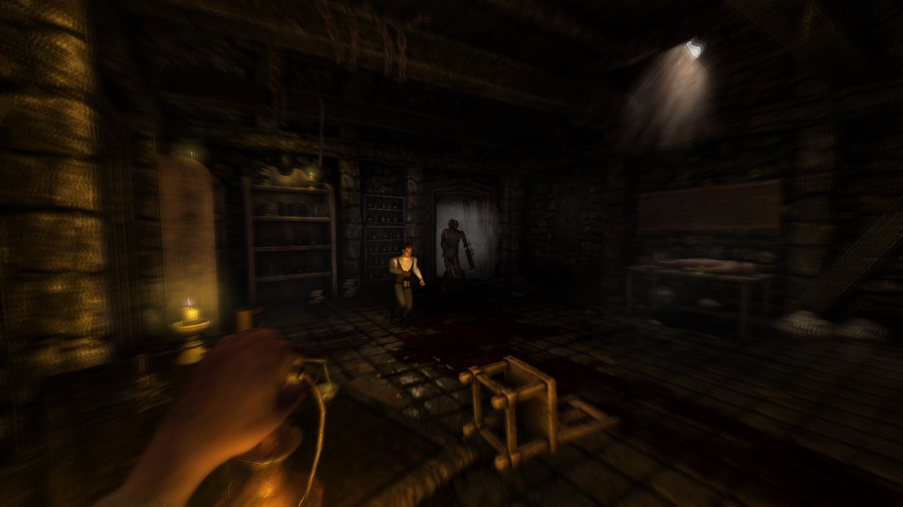
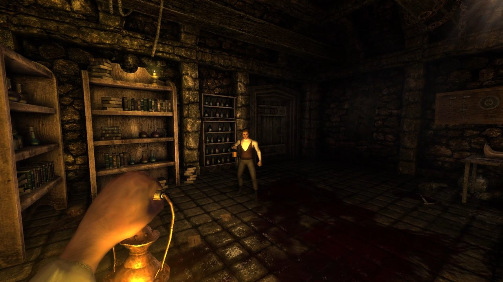
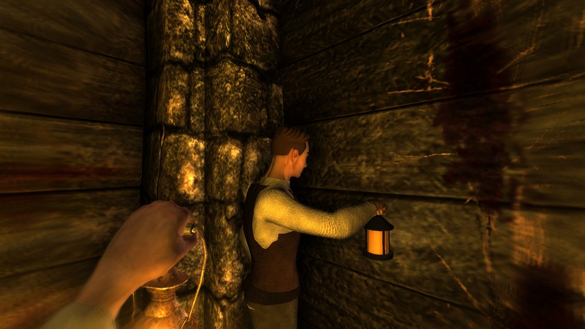
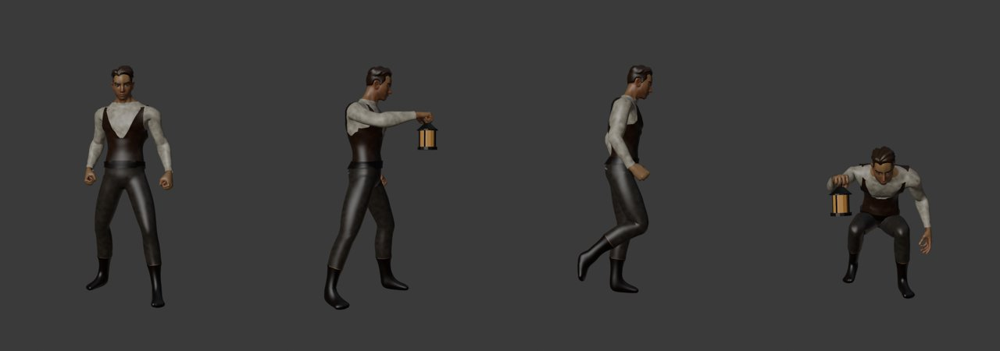

# Amnesia: The Dark Descent — Co-op

[](https://github.com/bogdanspbm/amnesia-the-dark-descent-coop/actions/workflows/build.yml)

Кооператив на двоих для **Amnesia: The Dark Descent**, сделанный на открытом исходном коде игры
([FrictionalGames/AmnesiaTheDarkDescent](https://github.com/FrictionalGames/AmnesiaTheDarkDescent), GPL v3).
Вся кампания, два игрока, два фонаря.

*Two-player co-op for Amnesia: The Dark Descent, built on the game's open-source code. [English below](#english).*



| | |
|---|---|
|  |  |
|  |  |
|  |  |

---

## Русский

> **Важно.** Мод **не содержит файлов игры**. Нужна своя лицензионная копия Amnesia: The Dark Descent (Steam/GOG)
> у каждого игрока. Код — GPL v3, как и исходники игры.

### Возможности

- **Прямое подключение по IP** (ENet, UDP 27960) — LAN, проброс порта, Radmin VPN / ZeroTier / Tailscale.
- **Steam-лобби** — хост для друзей / публичное лобби, поиск игр, приглашение через оверлей Steam
  (без IP и проброса портов).
- **Лобби в главном меню** — пункт «Co-op»: Host / Join / Leave / Start game / Continue together.
- **Общий мир** — двери, ящики, рычаги, подбираемые предметы, лампы, физические объекты синхронизируются;
  разрушение решает хост.
- **Монстры работают у хоста** и могут охотиться на любого из игроков.
- **Downed / revive** — «убитый» игрок лежит 60 с, напарник поднимает его, удерживая «Взаимодействие».
- **Continue together** — продолжить вдвоём с сохранения хоста, у каждого свой инвентарь.
- **Переходы между картами** вместе; отставший игрок подтягивается к напарнику на новом чекпоинте.
- **Модель напарника** — собственная (на основе CC0-паков Quaternius), с анимациями ходьбы/бега/приседа,
  фонарём в руке, реакцией на удар, лежачей позой.
- Для разработки: бот, проигрывающий сцены из XML, и запись видео сцены в MP4 средствами Windows.

### Статус и ограничения (честно)

- Кампания проходится вдвоём по прямому IP; основное тестирование — две копии игры на одном ПК.
- **Steam-лобби** работают через тестовый AppID 480 (Spacewar); полноценный тест двумя людьми на разных машинах
  через Steam ещё предстоит. Нужный `steam_api.dll` (Steamworks SDK 1.65) уже входит в Windows-релиз.
- **Linux и macOS** сборки собираются CI, но **не тестировались** в игре. macOS — экспериментально.
- Скриптовые сцены игры рассчитаны на одного игрока, поэтому в отдельных катсценах и триггерах возможны
  шероховатости. Совместное продолжение — с сохранения хоста (Continue together).
- Только 2 игрока.

### Установка

Коротко: распаковать релиз в папку игры и запускать `Amnesia_coop.exe`. Подробно, включая настройку сети,
порты, VPN, Steam и решение проблем: **[docs/NETWORK_PLAY.md](docs/NETWORK_PLAY.md)**.

1. Скачайте `amnesia-coop-<версия>-windows.zip` из [Releases](https://github.com/bogdanspbm/amnesia-the-dark-descent-coop/releases).
2. Распакуйте в папку игры (рядом с `Amnesia.exe`). Ничего из оригинала не перезаписывается.
3. При необходимости поставьте [VC++ Redistributable x86](https://aka.ms/vs/17/release/vc_redist.x86.exe).
4. Запустите `Amnesia_coop.exe` → главное меню → **Co-op**.

### Сборка из исходников

Подробно (Visual Studio, Steamworks SDK, Linux/macOS, частые ошибки): **[docs/BUILDING.md](docs/BUILDING.md)**.

**Windows** (Visual Studio 2022 / Build Tools с C++, Windows 10/11 SDK):

```powershell
.\build\build_windows.ps1                                        # без Steam (только прямой IP)
.\build\build_windows.ps1 -SteamworksSdk C:\SteamworksSDK\sdk    # со Steam-лобби (нужен свой Steamworks SDK)
```

Результат — `amnesia\redist\Amnesia.exe`; скопируйте его в папку игры как `Amnesia_coop.exe`, а
`coop_data\partner\*` — в `<папка игры>\_coop\partner\`.

**Linux / macOS** (экспериментально): команды — в [docs/BUILDING.md](docs/BUILDING.md#linux-экспериментально-в-игре-не-проверено), их же выполняет CI.

Steam-лобби в CMake включаются через `-DSTEAMWORKS_SDK_DIR=<sdk>`. Подробности по CI — `.github/workflows/build.yml`.

### Структура репозитория

| Путь | Что |
|---|---|
| `HPL2/`, `amnesia/` | Исходники игры и движка (Frictional Games, GPL v3) + изменения мода |
| `amnesia/src/game/LuxCoop*.cpp`, `LuxMainMenu_Coop.cpp` | Код кооператива: сеть, синхронизация, лобби, бот, запись |
| `amnesia/src/coop/` | ENet (MIT) и `coop.cfg.example` |
| `coop_data/partner/` | Модель напарника (CC0) → `<игра>\_coop\partner\` |
| `coop_data/scenes/` | Сцены для бота (разработка) |
| `tools/` | Скрипты разработки: запуск двух копий, запись, сборка модели напарника в Blender, монтаж |
| `docs/` | Документация и скриншоты |

### Благодарности и лицензия

- Код игры и движка — © Frictional Games, **GPL v3** ([LICENSE](LICENSE)). Изменения мода — тоже GPL v3.
- ENet — MIT. Модель напарника — на основе CC0-паков **Quaternius**. Полный список — [CREDITS.md](CREDITS.md).
- Amnesia: The Dark Descent — торговая марка Frictional Games. Это фанатский мод, не связанный с Frictional Games.

---

## English

> **Note.** The mod **includes no game files**. Each player needs their own copy of Amnesia: The Dark Descent
> (Steam/GOG). The code is GPL v3, like the game's source.

### Features

- **Direct IP** connection (ENet, UDP 27960): LAN, port forwarding, Radmin VPN / ZeroTier / Tailscale.
- **Steam lobbies**: friends-only or public lobby, lobby browser, invites through the Steam overlay — no IPs or ports.
- **Co-op lobby in the main menu**: Host / Join / Leave / Start game / Continue together.
- **Shared world**: doors, drawers, levers, pickups, lamps and physics props are synced; the host decides breaking.
- **Host-run enemies** that can hunt either player.
- **Downed / revive**: a "killed" player stays down for 60 s; the partner holds Interact to revive them.
- **Continue together** from the host's save, each player keeping their own inventory.
- **Map transitions together**; a player left behind joins the partner at the new checkpoint.
- **The mod's own partner model** (from CC0 Quaternius packs) with walk/run/crouch animations, a lantern in hand,
  hit flinch and a downed pose.
- For development: a bot that plays XML scenes, and MP4 recording of a scene with Windows' own encoders.

### Status and known limitations

- The campaign is playable by two over direct IP; most testing so far ran two game instances on one PC.
- **Steam lobbies** use the test AppID 480 (Spacewar); a real two-person test over Steam on separate machines is
  still pending. The required `steam_api.dll` (Steamworks SDK 1.65) ships with the Windows release.
- **Linux and macOS** builds are produced by CI but are **untested** in game; macOS is experimental.
- The game's scripted events were made for one player, so some cutscenes and triggers may behave oddly in co-op.
  Continuing together uses the host's save.
- Two players only.

### Install

Extract the release zip into the game folder and run `Amnesia_coop.exe`. Full guide (network setup, ports, VPNs,
Steam, troubleshooting): **[docs/NETWORK_PLAY.md](docs/NETWORK_PLAY.md#english)**.

### Build from source

Full guide (Visual Studio, Steamworks SDK, Linux/macOS, common errors): **[docs/BUILDING.md](docs/BUILDING.md#english)**.

Windows: `.\build\build_windows.ps1` (add `-SteamworksSdk <sdk folder>` for Steam lobbies) with Visual Studio 2022
(C++ workload) and a Windows 10/11 SDK; output `amnesia\redist\Amnesia.exe` → copy as `Amnesia_coop.exe`, and
`coop_data\partner\*` → `<game>\_coop\partner\`. Linux/macOS: CMake, see the commands above and
`.github/workflows/build.yml`.

### Credits and license

Game and engine code © Frictional Games, **GPL v3** ([LICENSE](LICENSE)); the mod's changes are GPL v3 too.
ENet is MIT; the partner model is built from CC0 packs by **Quaternius**. See [CREDITS.md](CREDITS.md).
Amnesia: The Dark Descent is a trademark of Frictional Games; this is an unofficial fan mod.


